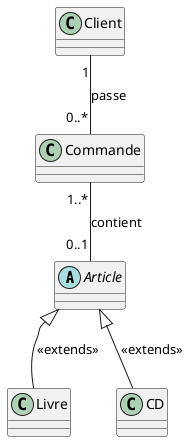
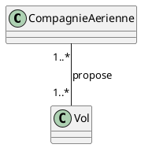
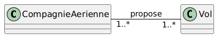
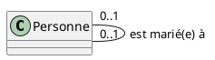
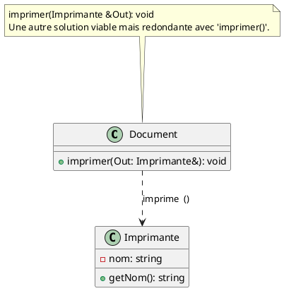
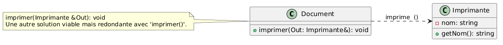
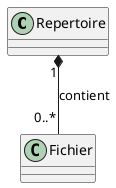
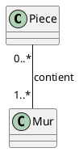
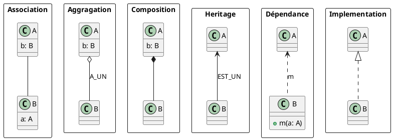

# TP 3 : Modélisation statique avec UML– Diagrammes de classes
## Exercice 1
**1) Pour chaque exemple ci-dessous, dessiner le diagramme de classes correspondant** <br>
- **A)** Dans le cadre d’un système de vente en ligne les livres et les CDs sont des articles. Les clients peuvent commander des articles

<br>

- **B)** Une compagnie aérienne propose des vols et un vol peut être proposé par différentes compagnies.

<br>

- **C)** D’après les textes de loi en 2018, en France deux personnes peuvent être mariées et une personne ne peut pas être mariée à deux autres personnes en même temps.

<br>

- **D)** Voici deux classes  ́ecrites en C++ 
```cpp
class Document
{
    public:
    void imprimer(Imprimante &Out);
};

class Imprimante
{
    public:
    string getNom() { return nom; }
};
```
Donnez le diagramme de classes correspondant.

<br>

- **E)** Un répertoire contient des fichiers. La suppression du répertoire implique la suppression de ses fichiers.

<br>

- **F)** Une pièce contient des murs (mais attention : un mur peut appartenir à deux pièces contiguës)

<br>

---
**2) Illustrez et expliquez toutes les relations entre les classes vues en cours. Proposez le code C++ des relations que vous connaissez.**

<br>

## Exercice 2
