# TP 3 : Modélisation statique avec UML– Diagrammes de classes
## Exercice 1
**1) Pour chaque exemple ci-dessous, dessiner le diagramme de classes correspondant** <br>
- **A)** Dans le cadre d’un système de vente en ligne les livres et les CDs sont des articles. Les clients peuvent commander des articles
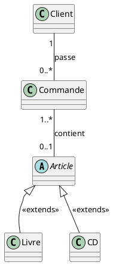
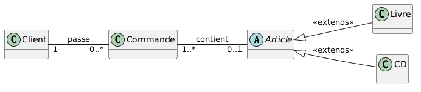<br>

- **B)** Une compagnie aérienne propose des vols et un vol peut être proposé par différentes compagnies.
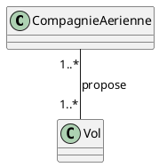
<br>

- **C)** D’après les textes de loi en 2018, en France deux personnes peuvent être mariées et une personne ne peut pas être mariée à deux autres personnes en même temps.
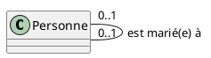
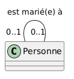<br>

- **D)** Voici deux classes  ́ecrites en C++ 
```cpp
class Document
{
    public:
    void imprimer(Imprimante &Out);
};

class Imprimante
{
    public:
    string getNom() { return nom; }
};
```
Donnez le diagramme de classes correspondant.
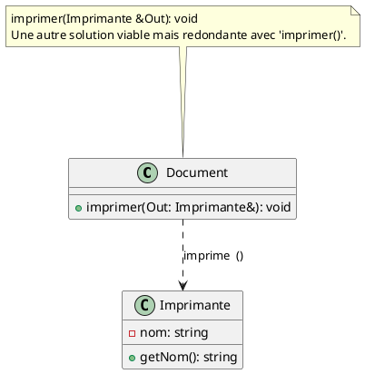
<br>

- **E)** Un répertoire contient des fichiers. La suppression du répertoire implique la suppression de ses fichiers.
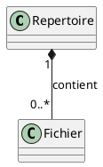
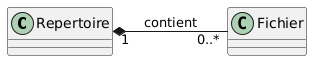<br>

- **F)** Une pièce contient des murs (mais attention : un mur peut appartenir à deux pièces contiguës)
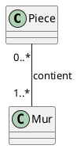
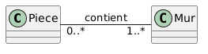<br>

---
**2) Illustrez et expliquez toutes les relations entre les classes vues en cours. Proposez le code C++ des relations que vous connaissez.**
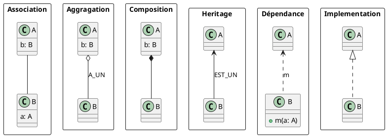
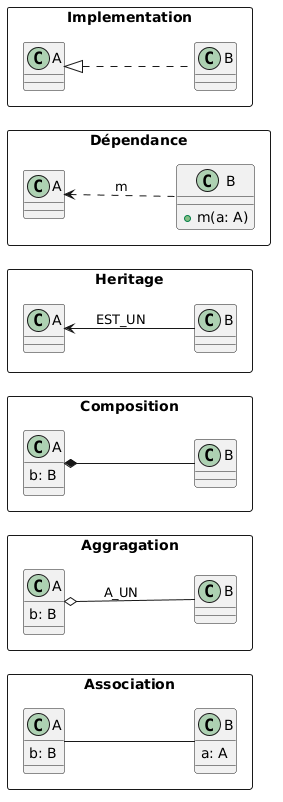<br>

## Exercice 2
**1) Réalisez le diagramme de classes du logiciel.**
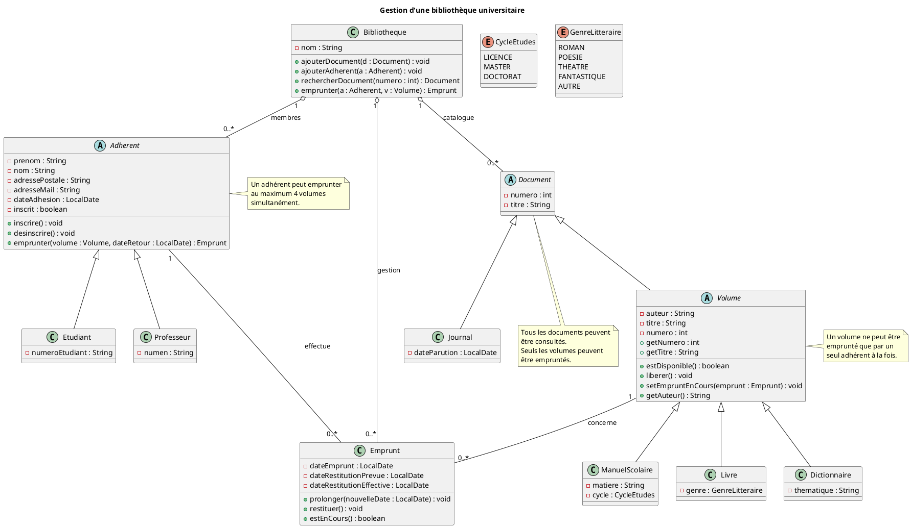
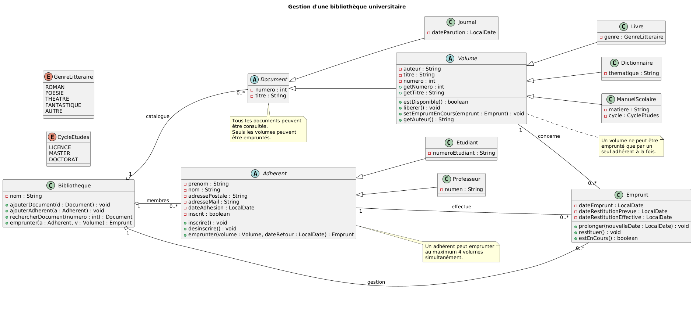<br>

---
**2) Proposez le code Java de deux ou trois classes de votre diagramme.**
1. `Adherent.java`
```java

import java.time.LocalDate;
import java.util.ArrayList;
import java.util.List;

public abstract class Adherent {

    private String prenom;
    private String nom;
    private String adressePostale;
    private String adresseMail;
    private LocalDate dateAdhesion;
    private boolean inscrit;

    private List<Emprunt> emprunts = new ArrayList<>();

    public Adherent(String prenom, String nom,
                    String adressePostale, String adresseMail) {

        this.prenom = prenom;
        this.nom = nom;
        this.adressePostale = adressePostale;
        this.adresseMail = adresseMail;
        this.dateAdhesion = LocalDate.now();
        this.inscrit = true;
    }

    public void inscrire() {
        inscrit = true;
    }

    public void desinscrire() {
        inscrit = false;
    }

    // Compter les emprunts non restitués
    public long nombreEmpruntsEnCours() {
        return emprunts.stream().filter(Emprunt::estEnCours).count();
    }

    // Emprunter un volume
    public Emprunt emprunter(Volume volume, LocalDate dateRetour) {

        if (!inscrit) {
            throw new IllegalStateException("L'adhérent n'est pas inscrit.");
        }

        if (nombreEmpruntsEnCours() >= 4) {
            throw new IllegalStateException("Maximum de 4 emprunts atteint.");
        }

        if (!volume.estDisponible()) {
            throw new IllegalStateException("Ce volume est déjà emprunté.");
        }

        if (!dateRetour.isAfter(LocalDate.now())) {
            throw new IllegalArgumentException("La date de retour doit être future.");
        }

        Emprunt emprunt = new Emprunt(volume, dateRetour);

        emprunts.add(emprunt);
        volume.setEmpruntEnCours(emprunt);

        return emprunt;
    }

    public List<Emprunt> getEmprunts() {
        return List.copyOf(emprunts);
    }
}
```

2. `Emprunt.java`
```java
import java.time.LocalDate;

public class Emprunt {
    private LocalDate dateEmprunt;
    private LocalDate dateRestitutionPrevue;
    private LocalDate dateRestitutionEffective;

    private Volume volume;

    public Emprunt(Volume volume, LocalDate dateRetour) {
        this.volume = volume;
        this.dateEmprunt = LocalDate.now();
        this.dateRestitutionPrevue = dateRetour;
        this.dateRestitutionEffective = null;
    }

    // Prolonger la durée de l'emprunt
    public void prolonger(LocalDate nouvelleDate) {

        if (!estEnCours()) {
            throw new IllegalStateException("Cet emprunt est déjà terminé.");
        }

        if (!nouvelleDate.isAfter(dateRestitutionPrevue)) {
            throw new IllegalArgumentException("La nouvelle date doit être ultérieure.");
        }

        dateRestitutionPrevue = nouvelleDate;
    }

    // Restituer le volume
    public void restituer() {

        if (!estEnCours()) {
            throw new IllegalStateException("Ce volume a déjà été restitué.");
        }

        dateRestitutionEffective = LocalDate.now();
        volume.liberer();
    }

    public boolean estEnCours() {
        return dateRestitutionEffective == null;
    }
}
```

3. `Volume.java`
```java
public abstract class Volume {

    private int numero;
    private String titre;
    private String auteur;

    private Emprunt empruntEnCours;

    public Volume(int numero, String titre, String auteur) {
        this.numero = numero;
        this.titre = titre;
        this.auteur = auteur;
    }

    public boolean estDisponible() {
        return empruntEnCours == null;
    }

    void setEmpruntEnCours(Emprunt emprunt) {
        this.empruntEnCours = emprunt;
    }

    void liberer() {
        this.empruntEnCours = null;
    }

    public int getNumero() {
        return numero;
    }

    public String getTitre() {
        return titre;
    }

    public String getAuteur() {
        return auteur;
    }
}
```